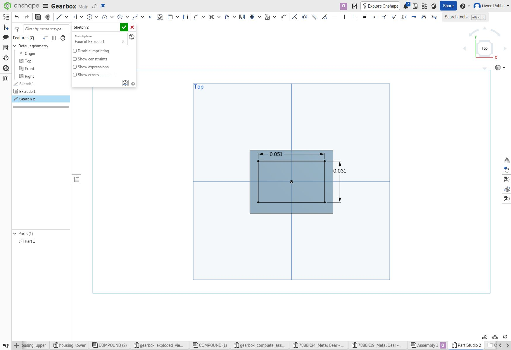
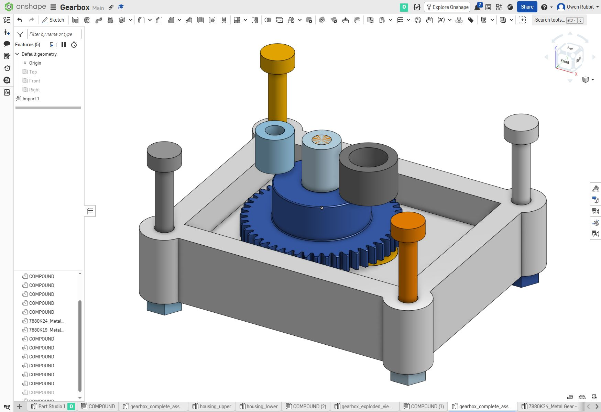
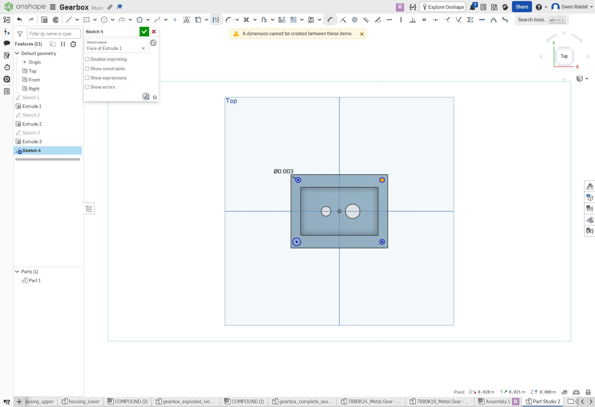
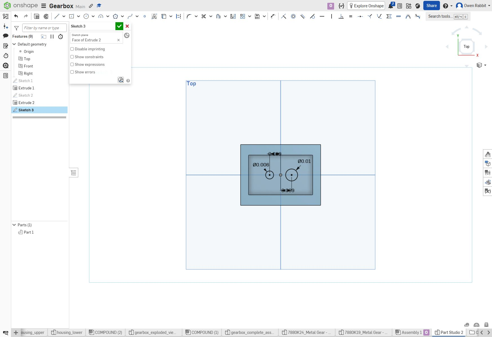
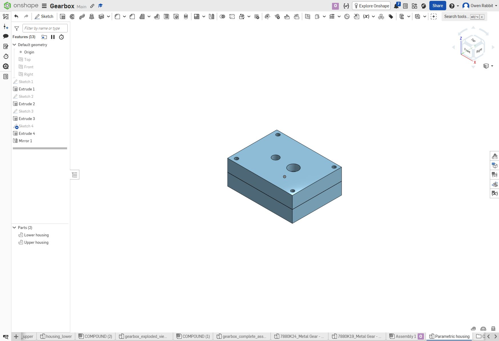
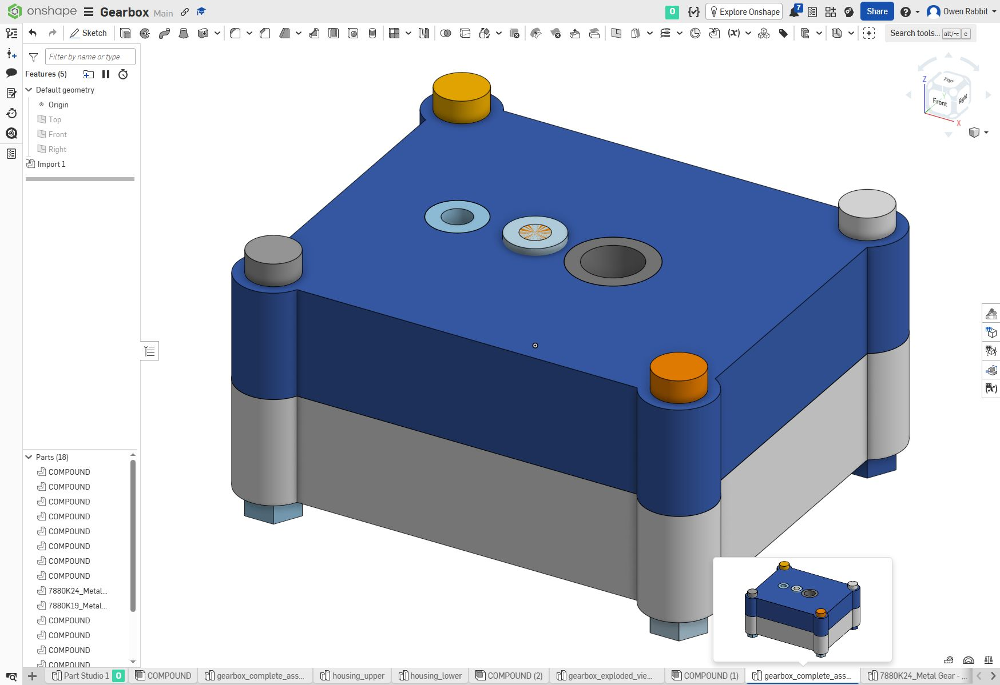
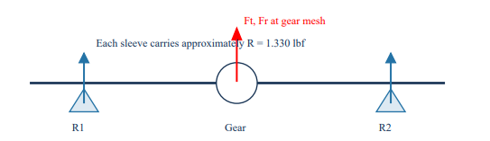
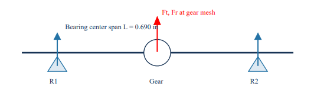
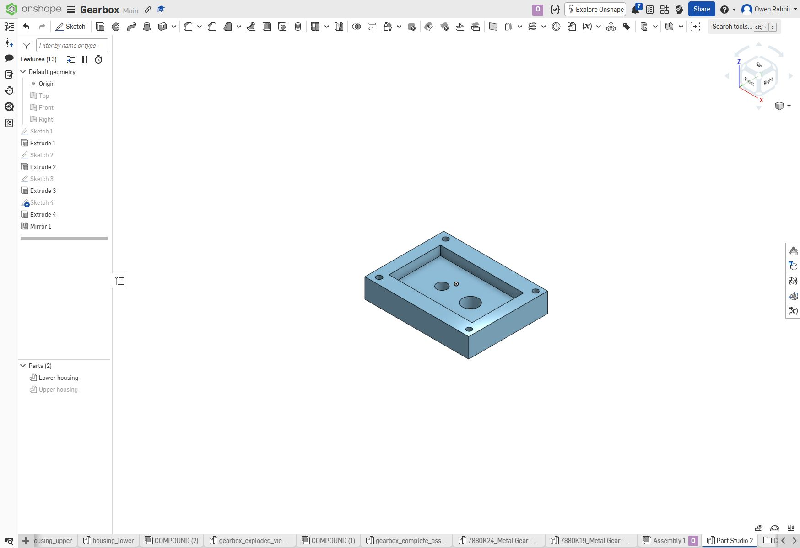

# MEGR 2156 – Gearbox Design and Shaft Analysis

> **Portfolio Documentation Disclaimer:** External engineering tools, Onshape CAD software, and AI-assisted formatting were used in preparing this documentation. All engineering calculations were performed by hand. AI was used extensively to restructure, format, and improve the presentation of this assignment. This project is intended to become a featured piece of my mechanical engineering portfolio, which is why additional attention was given to its organization and visual presentation.

---

## 1. Project Overview

The objective of this assignment was to design a gearbox that can be assembled and disassembled while analyzing the mechanical requirements of its shafts and bearings.

The project involved developing a parametric gearbox housing in Onshape, establishing shaft and gear locations, evaluating bearing reactions, and documenting the resulting assembly.

### Project Objectives

- Design a gearbox capable of assembly and disassembly.
- Develop a two-piece gearbox housing.
- Establish shaft and gear locations.
- Analyze shaft loading and bearing reactions.
- Evaluate suitable sleeve bearings.
- Incorporate fastening and mounting features.
- Produce parametric CAD models and assembly documentation.

### Design Tools

| Tool | Application |
|---|---|
| Onshape | Parametric CAD modeling |
| Engineering mechanics | Shaft and bearing analysis |
| Hand calculations | Strength and loading calculations |
| Engineering drawings | Dimensional documentation |
| GitHub | Portfolio documentation |

---

## 2. Gearbox Housing Design

### 2.1 Housing Configuration

The gearbox was designed using a two-piece rectangular housing consisting of a removable upper section and a lower support structure.

The lower housing provides an internal cavity for the gears and shaft components. The upper housing encloses the assembly while allowing access for maintenance and disassembly.

### Housing Features

| Feature | Description |
|---|---|
| Configuration | Two-piece rectangular enclosure |
| Upper housing | Removable cover |
| Lower housing | Gear and shaft support |
| Internal cavity | Rectangular recessed pocket |
| Shaft openings | Two circular openings |
| Fastening locations | Four corner mounting holes |
| Bearing support | Sleeve bearing locations |

### 2.2 Internal Cavity

The internal cavity was created using a rectangular sketch followed by an extruded material removal.

| Parameter | Dimension |
|---|---:|
| Cavity length | 0.051 m |
| Cavity width | 0.031 m |
| Cavity length | 51 mm |
| Cavity width | 31 mm |

*Figure 1. Internal gearbox cavity sketch showing dimensional constraints.*

### 2.3 Shaft Openings

Two circular openings were incorporated into the housing to accommodate the shaft and bearing arrangements.

| Opening | Diameter |
|---|---:|
| Opening 1 | 6 mm |
| Opening 2 | 10 mm |

*Figure 2. Shaft opening geometry and dimensional constraints.*

### 2.4 Mounting Features

Four mounting holes were positioned near the housing corners to accommodate fastening hardware.

The mounting geometry was created using sketch, extrusion, and mirror operations.

| Parameter | Value |
|---|---|
| Number of holes | 4 |
| Hole diameter | 3 mm |
| Arrangement | Four corners |
| CAD operations | Sketch, Extrude, Mirror |

*Figure 3. Mounting hole locations and dimensional constraints.*

---

## 3. Parametric CAD Development

### 3.1 Lower Housing

The lower housing was modeled using a rectangular base, recessed cavity, shaft openings, and mounting features.

*Figure 4. Lower housing with internal cavity, shaft openings, and fastening holes.*

### 3.2 Upper Housing

The upper housing was modeled as a removable cover corresponding to the lower housing geometry.

*Figure 5. Upper and lower housing components.*

### 3.3 Completed Housing

Both housing sections were positioned together to evaluate alignment and the completed enclosure geometry.

*Figure 6. Completed two-piece gearbox housing.*

### CAD Feature Summary

| Feature | Modeling Method |
|---|---|
| Housing base | Sketch and Extrude |
| Internal cavity | Extrude Remove |
| Shaft openings | Circular sketch and Extrude |
| Mounting holes | Circular sketch and Extrude |
| Repeated features | Mirror |
| Upper housing | Corresponding cover geometry |
| Completed housing | Two-piece enclosure |

---

## 4. Shaft Loading Analysis

### 4.1 Shaft Loading Conditions

The shaft was modeled as a simply supported beam with the gear positioned between two bearing supports.

The gear transmits tangential and radial forces that produce bending loads on the shaft.

The analysis considers:

- Tangential gear force, Ft
- Radial gear force, Fr
- Bearing reaction R1
- Bearing reaction R2
- Bearing center span L

### 4.2 Free-Body Diagram

*Figure 7. Shaft free-body diagram showing the bearing reactions and gear loading.*

### 4.3 Bearing Reactions

For a centered transverse load, the two bearing reactions are equal.

Static equilibrium requires:

\[
\sum F_y = 0
\]

\[
R_1 + R_2 = F
\]

Taking moments about the first support:

\[
\sum M_1 = 0
\]

\[
R_2L-F\left(\frac{L}{2}\right)=0
\]

Therefore:

\[
R_2=\frac{F}{2}
\]

\[
R_1=\frac{F}{2}
\]

The calculated bearing reaction is:

\[
R_1=R_2=1.330\text{ lbf}
\]

The corresponding total transverse load is:

\[
F=2(1.330)
\]

\[
\boxed{F=2.660\text{ lbf}}
\]

Converting to SI units:

\[
F=2.660(4.44822)
\]

\[
\boxed{F=11.83\text{ N}}
\]

The load is assumed to act centrally between the two supports. Tangential and radial gear forces must be resolved in their respective planes when calculating the combined shaft loading.

### 4.4 Bearing Center Span

*Figure 8. Bearing center span used for shaft bending analysis.*

The bearing center span is:

\[
L=0.690\text{ in}
\]

Converting to millimeters:

\[
L=0.690(25.4)
\]

\[
\boxed{L=17.526\text{ mm}}
\]

### 4.5 Maximum Bending Moment

For a simply supported beam with a centered transverse load:

\[
M_{max}=\frac{FL}{4}
\]

Substituting the calculated values:

\[
M_{max}=\frac{(2.660)(0.690)}{4}
\]

\[
\boxed{M_{max}=0.4589\text{ lbf}\cdot\text{in}}
\]

Converting to SI units:

\[
M_{max}=0.4589(0.112985)
\]

\[
\boxed{M_{max}=0.05185\text{ N}\cdot\text{m}}
\]

### Shaft Loading Results

| Parameter | Result |
|---|---:|
| Bearing center span | 0.690 in |
| Bearing center span | 17.526 mm |
| Reaction R1 | 1.330 lbf |
| Reaction R2 | 1.330 lbf |
| Total transverse load | 2.660 lbf |
| Total transverse load | 11.83 N |
| Maximum bending moment | 0.4589 lbf·in |
| Maximum bending moment | 0.05185 N·m |

---

## 5. Shaft Strength Evaluation

### 5.1 Bending Stress

The shaft must resist bending produced by the transverse gear loading.

For a solid circular shaft:

\[
\sigma_b=\frac{32M}{\pi d^3}
\]

Where:

- M = Maximum bending moment
- d = Shaft diameter

Using the calculated bending moment:

\[
\sigma_b=\frac{32(51.85)}{\pi d^3}
\]

For this expression, M is in N·mm and d is in mm, producing stress in MPa.

### 5.2 Torsional Shear Stress

The shaft also experiences torsional loading from power transmission.

The nominal torsional shear stress is:

\[
\tau=\frac{16T}{\pi d^3}
\]

Where:

- T = Transmitted torque
- d = Shaft diameter

### 5.3 Combined Stress

For combined bending and torsion, the von Mises equivalent stress is:

\[
\sigma_{VM}=\sqrt{\sigma_b^2+3\tau^2}
\]

The static yield factor of safety is:

\[
n=\frac{S_y}{\sigma_{VM}}
\]

Where Sy represents the material yield strength.

### Shaft Strength Summary

| Parameter | Method |
|---|---|
| Bending moment | Static equilibrium |
| Bending stress | Flexure equation |
| Torsional stress | Circular shaft torsion equation |
| Equivalent stress | von Mises criterion |
| Factor of safety | Yield strength / equivalent stress |

The final numerical factor of safety requires the shaft material, transmitted torque, and critical shaft diameter.

---

## 6. Sleeve Bearing Selection

### 6.1 Bearing Requirements

Sleeve bearings were considered for supporting the gearbox shafts.

The bearings must provide sufficient radial support while maintaining acceptable friction, wear, and dimensional compatibility.

The calculated radial reaction used for preliminary bearing evaluation is:

\[
R=1.330\text{ lbf}=5.92\text{ N}
\]

### 6.2 Bearing Pressure

Projected bearing pressure is calculated using:

\[
P=\frac{F}{dL_b}
\]

Where:

- P = Bearing pressure
- F = Radial bearing load
- d = Shaft diameter
- Lb = Bearing length

Using the calculated bearing reaction:

\[
P=\frac{5.92}{dL_b}
\]

With d and Lb in millimeters, P is expressed in MPa.

### 6.3 Candidate Shaft Diameters

For a 6 mm shaft:

\[
P_6=\frac{5.92}{6L_b}
\]

\[
\boxed{P_6=\frac{0.987}{L_b}\text{ MPa}}
\]

For a 10 mm shaft:

\[
P_{10}=\frac{5.92}{10L_b}
\]

\[
\boxed{P_{10}=\frac{0.592}{L_b}\text{ MPa}}
\]

In these expressions, Lb is entered numerically in millimeters.

### 6.4 Preliminary Bearing Pressure Comparison

The following table compares hypothetical bearing lengths under the same radial loading.

| Bearing Length | 6 mm Shaft | 10 mm Shaft |
|---|---:|---:|
| 5 mm | 0.197 MPa | 0.118 MPa |
| 8 mm | 0.123 MPa | 0.074 MPa |
| 10 mm | 0.099 MPa | 0.059 MPa |
| 12 mm | 0.082 MPa | 0.049 MPa |

These values represent calculated projected pressures rather than verified manufacturer bearing ratings.

### 6.5 Pressure-Velocity Considerations

Bearing suitability also depends on rotational speed.

The pressure-velocity relationship is:

\[
PV=P\cdot V
\]

For a rotating shaft:

\[
V=\frac{\pi dN}{60}
\]

Where:

- V = Shaft surface velocity in m/s
- d = Shaft diameter in meters
- N = Rotational speed in rpm

The resulting PV value must remain within the manufacturer's allowable operating range.

### Bearing Selection Summary

| Requirement | Evaluation |
|---|---|
| Bearing type | Sleeve bearing |
| Radial load | 5.92 N |
| Candidate shaft diameters | 6 mm and 10 mm |
| Bearing pressure | Calculated from projected area |
| Bearing length | Dependent on selected bearing |
| Operating speed | Required for PV evaluation |
| Material | Requires manufacturer specification |
| Housing compatibility | Requires dimensional verification |

The bearing dimensions and material must be verified against the available components before final selection.

---

## 7. Gearbox Assembly

### 7.1 Completed Assembly

The gearbox assembly incorporates the housing, gears, shaft support components, and fastening hardware.

*Figure 9. Complete gearbox assembly showing the housing, bearing locations, and fastening hardware.*

### 7.2 Internal Gear Arrangement

The upper housing was removed from the CAD view to inspect the internal gear arrangement and component positioning.

*Figure 10. Gearbox assembly with the upper housing removed.*

### 7.3 Assembly Procedure

The general assembly procedure is:

1. Prepare the lower gearbox housing.
2. Install the selected bearing components.
3. Position the shafts and gears.
4. Verify internal alignment and clearances.
5. Position the upper housing.
6. Install the fastening hardware.
7. Verify the intended shaft rotation and component clearances.

Disassembly follows the reverse procedure.

### Assembly Evaluation

| Requirement | Design Feature |
|---|---|
| Gear enclosure | Two-piece housing |
| Internal access | Removable upper housing |
| Shaft support | Sleeve bearings |
| Gear clearance | Recessed internal cavity |
| Housing fastening | Four corner mounting locations |
| CAD representation | Complete assembly model |

---

## 8. Design Results

The completed CAD design incorporates a removable housing, shaft openings, bearing support locations, gear components, and fastening features.

The analytical portion establishes preliminary bearing reactions and shaft bending loads.

### Final Results Summary

| Category | Result |
|---|---|
| CAD software | Onshape |
| Housing configuration | Two-piece |
| Internal cavity | 51 mm × 31 mm |
| Shaft openings | 6 mm and 10 mm |
| Mounting hole diameter | 3 mm |
| Mounting locations | 4 |
| Bearing center span | 17.526 mm |
| Bearing reaction | 5.92 N per bearing |
| Total transverse load | 11.83 N |
| Maximum bending moment | 0.05185 N·m |
| Bearing type | Sleeve bearing |
| Assembly configuration | Removable upper housing |

### Engineering Observations

The parametric modeling process allows modifications to the housing dimensions, shaft locations, and mounting geometry without requiring complete reconstruction.

The two-piece enclosure provides access to internal mechanical components and supports the assignment requirement for assembly and disassembly.

The shaft analysis establishes preliminary loading conditions for evaluating shaft strength and selecting bearings.

Further verification is required for the final shaft factor of safety, bearing specifications, dimensional tolerances, and physical operation.

---

## 9. Conclusion

This assignment involved the development of a gearbox housing and the mechanical evaluation of its shaft support arrangement.

The parametric CAD model demonstrates the integration of gear components, shaft openings, bearing locations, and fastening features into a removable two-piece enclosure.

Static equilibrium was used to calculate bearing reactions and the maximum shaft bending moment. Sleeve bearing pressure calculations were also developed to compare potential bearing dimensions.

The project demonstrates the relationship between mechanical design, engineering analysis, component selection, and parametric CAD development.

Further development would include final shaft material selection, bearing specification, manufacturing tolerances, and physical assembly testing.

---

## 10. Project Deliverables

| Deliverable | Documentation |
|---|---|
| Housing geometry | Figures 1–6 |
| Shaft free-body diagram | Figure 7 |
| Bearing span diagram | Figure 8 |
| Completed gearbox assembly | Figure 9 |
| Internal assembly | Figure 10 |
| Shaft analysis | Sections 4–5 |
| Sleeve bearing evaluation | Section 6 |
| Engineering tables | Throughout documentation |
| Parametric CAD | Onshape gearbox document |

**Course:** MEGR 2156 – Design Projects Lab I

**Project:** Gearbox Design and Shaft Analysis

**Software:** Onshape
